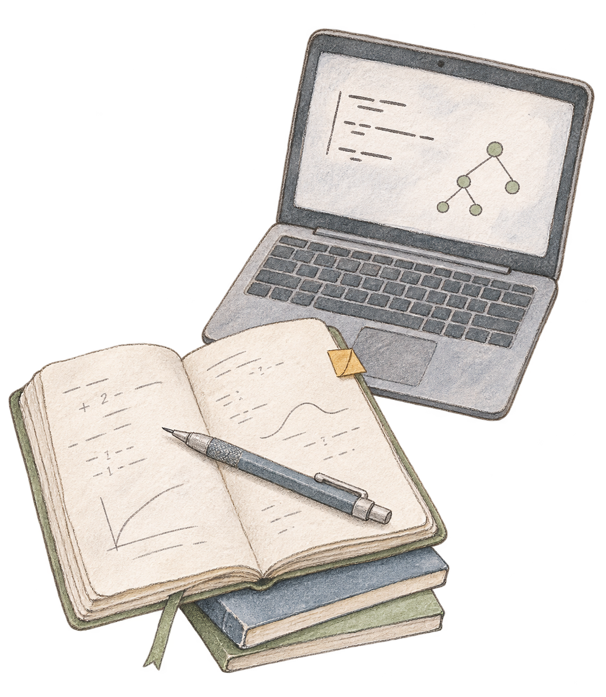
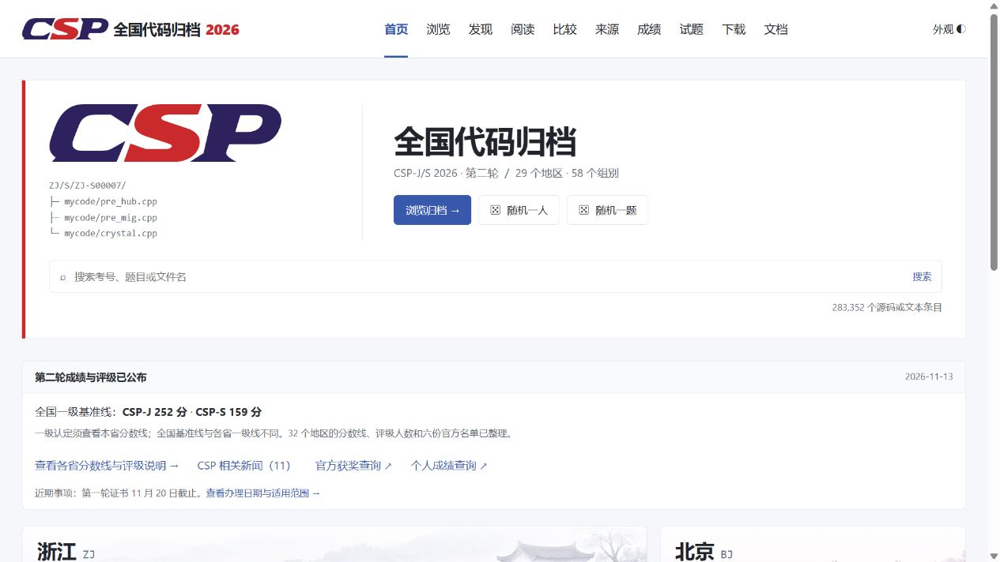
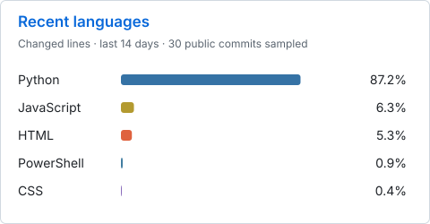
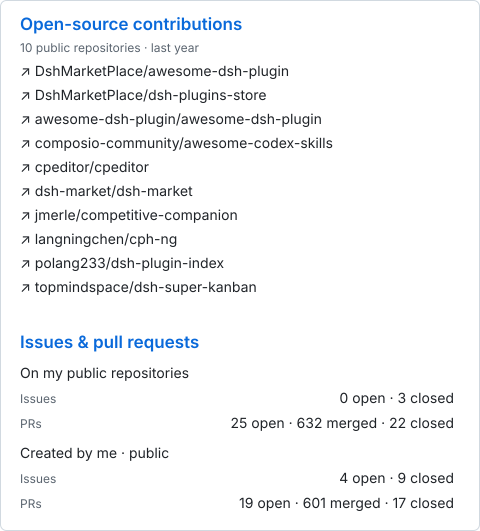
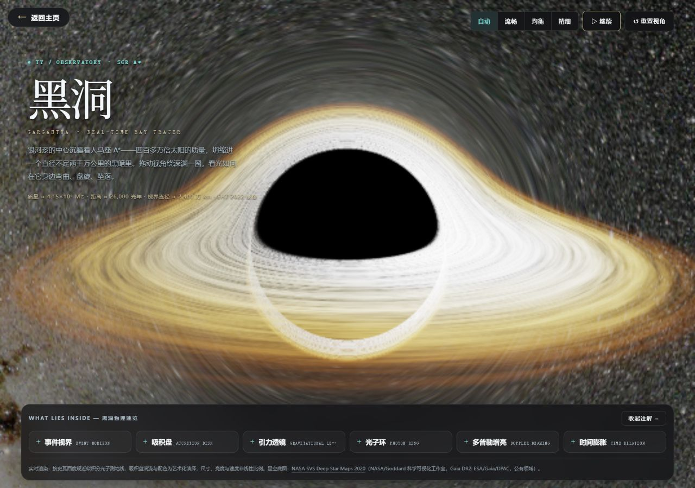
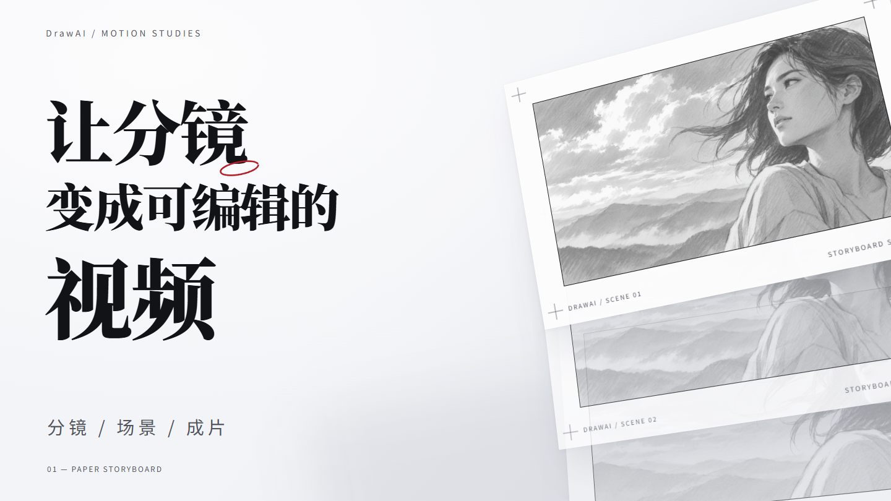

### Hi there 👋

I'm **Tang Yixiao**, a high-school student at **Shaoxing No.1 High School**.

I mainly study **competitive programming, mathematics and physics**. Outside problem solving, I build AI coding tools, community plugins for DeepSeek Harness, and small web and visualization experiments.

- 🧩 Working through models, algorithms, proofs and implementations.
- 🛠️ Building tools I want to use, then maintaining and improving them.
- ✍️ Keeping explanations, derivations and experiment notes I can revisit later.

**[Website](https://tangyixiao.github.io/)** · [Blog](https://tangyixiao.github.io/blog/) · [Luogu](https://www.luogu.com.cn/blog/TangyixiaoQAQ/) · **[简体中文](README.md)**

---

## GitHub activity

<a href="https://github.com/tangyixiao">
<picture>
<source media="(prefers-color-scheme: dark) and (max-width: 640px)" srcset="https://github-stats-extended.vercel.app/api?username=tangyixiao&amp;show_icons=true&amp;include_all_commits=true&amp;hide_border=false&amp;border_radius=6&amp;bg_color=0d1117&amp;title_color=9db9d1&amp;text_color=c5cdd7&amp;icon_color=98ad9f&amp;border_color=30363d&amp;hide_rank=true&amp;show=prs_merged,prs_merged_percentage">
<source media="(max-width: 640px)" srcset="https://github-stats-extended.vercel.app/api?username=tangyixiao&amp;show_icons=true&amp;include_all_commits=true&amp;hide_border=false&amp;border_radius=6&amp;bg_color=ffffff&amp;title_color=45648a&amp;text_color=455467&amp;icon_color=759180&amp;border_color=d9e1e8&amp;hide_rank=true&amp;show=prs_merged,prs_merged_percentage">
<source media="(prefers-color-scheme: dark)" srcset="https://github-stats-extended.vercel.app/api?username=tangyixiao&amp;show_icons=true&amp;include_all_commits=true&amp;hide_border=false&amp;border_radius=6&amp;bg_color=0d1117&amp;title_color=9db9d1&amp;text_color=c5cdd7&amp;icon_color=98ad9f&amp;border_color=30363d&amp;show=prs_merged,prs_merged_percentage">

</picture>
</a>
<a href="https://github.com/tangyixiao?tab=repositories">
<picture>
<source media="(prefers-color-scheme: dark) and (max-width: 640px)" srcset="https://github-stats-extended.vercel.app/api/top-langs/?username=tangyixiao&amp;layout=compact&amp;langs_count=8&amp;card_width=300&amp;border_radius=6&amp;bg_color=0d1117&amp;title_color=9db9d1&amp;text_color=c5cdd7&amp;icon_color=98ad9f&amp;border_color=30363d">
<source media="(max-width: 640px)" srcset="https://github-stats-extended.vercel.app/api/top-langs/?username=tangyixiao&amp;layout=compact&amp;langs_count=8&amp;card_width=300&amp;border_radius=6&amp;bg_color=ffffff&amp;title_color=45648a&amp;text_color=455467&amp;icon_color=759180&amp;border_color=d9e1e8">
<source media="(prefers-color-scheme: dark)" srcset="https://github-stats-extended.vercel.app/api/top-langs/?username=tangyixiao&amp;layout=compact&amp;langs_count=8&amp;card_width=450&amp;border_radius=6&amp;bg_color=0d1117&amp;title_color=9db9d1&amp;text_color=c5cdd7&amp;icon_color=98ad9f&amp;border_color=30363d">

</picture>
</a>

<a href="https://github.com/tangyixiao">
<picture>
<source media="(prefers-color-scheme: dark) and (max-width: 640px)" srcset="https://streak-stats.demolab.com?user=tangyixiao&amp;hide_border=false&amp;border_radius=6&amp;card_width=390&amp;card_height=195&amp;background=0D1117&amp;border=30363D&amp;stroke=30363D&amp;ring=759180&amp;fire=759180&amp;currStreakNum=C5CDD7&amp;sideNums=C5CDD7&amp;currStreakLabel=9DB9D1&amp;sideLabels=9DB9D1&amp;dates=A5B0BD">
<source media="(max-width: 640px)" srcset="https://streak-stats.demolab.com?user=tangyixiao&amp;hide_border=false&amp;border_radius=6&amp;card_width=390&amp;card_height=195&amp;background=FFFFFF&amp;border=D9E1E8&amp;stroke=D9E1E8&amp;ring=759180&amp;fire=759180&amp;currStreakNum=455467&amp;sideNums=455467&amp;currStreakLabel=45648A&amp;sideLabels=45648A&amp;dates=65758A">
<source media="(prefers-color-scheme: dark)" srcset="https://streak-stats.demolab.com?user=tangyixiao&amp;hide_border=false&amp;border_radius=6&amp;card_width=840&amp;card_height=195&amp;background=0D1117&amp;border=30363D&amp;stroke=30363D&amp;ring=759180&amp;fire=759180&amp;currStreakNum=C5CDD7&amp;sideNums=C5CDD7&amp;currStreakLabel=9DB9D1&amp;sideLabels=9DB9D1&amp;dates=A5B0BD">

</picture>
</a>

## Selected projects

<a href="https://github.com/tangyixiao/dsh-workbuddy-connect-community"><picture>
<source media="(prefers-color-scheme: dark)" srcset="https://github-stats-extended.vercel.app/api/pin/?username=tangyixiao&amp;repo=dsh-workbuddy-connect-community&amp;card_width=390&amp;description_lines_count=3&amp;border_radius=6&amp;bg_color=0d1117&amp;title_color=9db9d1&amp;text_color=c5cdd7&amp;icon_color=98ad9f&amp;border_color=30363d">

</picture></a>
<a href="https://github.com/tangyixiao/drawai-video-studio"><picture>
<source media="(prefers-color-scheme: dark)" srcset="https://github-stats-extended.vercel.app/api/pin/?username=tangyixiao&amp;repo=drawai-video-studio&amp;card_width=390&amp;description_lines_count=3&amp;border_radius=6&amp;bg_color=0d1117&amp;title_color=9db9d1&amp;text_color=c5cdd7&amp;icon_color=98ad9f&amp;border_color=30363d">

</picture></a>
<a href="https://github.com/tangyixiao/dsh-plugin-market"><picture>
<source media="(prefers-color-scheme: dark)" srcset="https://github-stats-extended.vercel.app/api/pin/?username=tangyixiao&amp;repo=dsh-plugin-market&amp;card_width=390&amp;description_lines_count=3&amp;border_radius=6&amp;bg_color=0d1117&amp;title_color=9db9d1&amp;text_color=c5cdd7&amp;icon_color=98ad9f&amp;border_color=30363d">

</picture></a>
<a href="https://github.com/tangyixiao/tangyixiao.github.io"><picture>
<source media="(prefers-color-scheme: dark)" srcset="https://github-stats-extended.vercel.app/api/pin/?username=tangyixiao&amp;repo=tangyixiao.github.io&amp;card_width=390&amp;description_lines_count=3&amp;border_radius=6&amp;bg_color=0d1117&amp;title_color=9db9d1&amp;text_color=c5cdd7&amp;icon_color=98ad9f&amp;border_color=30363d">

</picture></a>

## Recent progress

Lately I have been organizing CSP resources and maintaining OJ tools, AI coding workflows and learning skills. These are a few public releases checked on **2026-11-15**:

| Date | Project and version | Purpose |
| --- | --- | --- |
| Nov 14 | [WorkBuddy Connect Community · v0.1.20](https://github.com/tangyixiao/dsh-workbuddy-connect-community/releases/tag/v0.1.20) | WorkBuddy / WorkBuddy AI access in DSH |
| Nov 14 | [PR & Release Workspace · v0.1.6](https://github.com/tangyixiao/dsh-pr-release-workspace/releases/tag/v0.1.6) | PRs, diffs, local notes and release checks |
| Nov 10 | [DrawAI Video Studio · v0.1.2](https://github.com/tangyixiao/drawai-video-studio/releases/tag/v0.1.2) | Making, rendering and inspecting videos with code |
| Nov 1 | [OJ NEXUS · v1.0.4](https://github.com/tangyixiao/OJ-NEXUS/releases/tag/v1.0.4) | Android client for multiple online judges |

## Competitive programming and learning

I treat competitive programming as a long-term learning project: read the problem, build a model, analyze complexity and implement the idea. I also want the problems, resources and tools I organize to remain useful the next time I study.

**[CSP-2026](https://github.com/tangyixiao/CSP-2026)** 
An archive of CSP-J/S 2026 papers and contestant files. It supports reading papers, browsing code, side-by-side and inline comparisons, and downloads for post-contest study and review.

[Online archive](https://tangyixiao.github.io/CSP-2026/) · [Paper PDFs](https://tangyixiao.github.io/CSP-2026/papers/) · [Code reading and comparison](https://tangyixiao.github.io/CSP-2026/code/)

**[OJ NEXUS](https://github.com/tangyixiao/OJ-NEXUS)** 
A multi-OJ client primarily for Android, bringing together accounts, submissions, problems, contests, training and review. Notes, history and statistics are local-first; work on other platforms is ongoing.

**[oi-coach](https://github.com/tangyixiao/oi-coach) / [evidence-learning](https://github.com/tangyixiao/evidence-learning)** 
Two teaching and learning skills for AI assistants. The first focuses on OI explanations, graded hints, code review and post-contest reflection; the second collects study records, review methods and delayed practice for high-school learning. They are also part of my own ongoing effort to improve how I learn.

More learning resources and records

- [CSP-ChuSai](https://github.com/tangyixiao/CSP-ChuSai): self-made preliminary-round practice papers, solutions and explanations, alongside historical materials. The self-made papers are not official contest papers.
- [Shaoxing No.1 High School Beamer Template](https://github.com/tangyixiao/Shaoxing-No.1-High-School-LaTeX-Beamer-Template): a LaTeX presentation template.
- [tangyixiao-skills](https://github.com/tangyixiao/tangyixiao-skills): a backup and sync collection of personal Codex skills, retaining their sources and licenses.

Two previously recorded Luogu milestones:

- **2026.01 — 1000 AC**
- **2026.06 — 2000 AC**

## AI coding tools and community plugins

I am interested in how LLMs, agents and coding tools fit into practical workflows: where projects live, how sessions continue, how models connect and how failures can be diagnosed.

**[Harness Hub](https://github.com/tangyixiao/HarnessHub)** 
A local-first desktop hub for AI coding. It registers projects, discovers local harnesses, manages supported terminal sessions, and shows activity, usage and Git changes observed during a session.

**[WorkBuddy Connect Community](https://github.com/tangyixiao/dsh-workbuddy-connect-community)** 
A community WorkBuddy connection plugin for DeepSeek Harness. It reuses WorkBuddy / WorkBuddy AI desktop sign-in for separate model access, context options and observed usage.

**[DSH Plugin Market](https://github.com/tangyixiao/dsh-plugin-market) / [dsh-plugins-sync](https://github.com/tangyixiao/dsh-plugins-sync)** 
A public plugin index and market entry point, alongside a repository of catalog snapshots from multiple sources. They make sources, versions, channels and conflicts easier to inspect when discovering plugins.

Other DSH tools I maintain

| Tool | Purpose |
| --- | --- |
| [PR & Release Workspace](https://github.com/tangyixiao/dsh-pr-release-workspace) | Read PRs and diffs, keep local notes and check release records |
| [Provider Doctor](https://github.com/tangyixiao/dsh-provider-doctor) | Diagnose model connections through host, installation, registration and credentials |
| [Version Manager](https://github.com/tangyixiao/dsh-version-manager) | Inspect installed plugins and skills, update previews and snapshots |
| [ZCode Plan Bridge](https://github.com/tangyixiao/dsh-zcode-plan-bridge) | Route DSH model requests through a signed-in local ZCode CLI |

The individual repositories document origins, compatibility and usage for community plugins and adapted projects.

### Recent development and collaboration

## Websites, visualization and expression

**[Personal website](https://tangyixiao.github.io/) / [Source](https://github.com/tangyixiao/tangyixiao.github.io)** 
A home for projects, blog posts and small standalone experiments. Alongside pages and interactions, I enjoy exploring how mathematical and physical phenomena can be visualized and experimented with.

🌌 [Black hole and gravitational lensing](https://tangyixiao.github.io/blackhole.html) · [Three-body gravity](https://tangyixiao.github.io/threebody.html) · [Double pendulum and chaos](https://tangyixiao.github.io/thechao.html)

**[DrawAI Video Studio](https://github.com/tangyixiao/drawai-video-studio)** 
A Remotion / React video-production skill, from references, storyboards and short pilots to editable scenes, rendering and visual checks. I am also exploring how explanations and demonstrations can become easier to follow.

## A few things I have written

These posts are currently in Chinese.

- **[From one problem to a reusable explanation](https://tangyixiao.github.io/blog/posts/problem-to-note.html)** 
  Starting with a model and a simple baseline, then explaining observations, correctness, complexity and edge cases.
- **[Keep the reasoning, keep the understanding](https://tangyixiao.github.io/blog/posts/proof-and-notes.html)** 
  Notes should preserve conditions, reasons for each step and unresolved questions, alongside the result.
- **[Understanding agents through a small experiment](https://tangyixiao.github.io/blog/posts/agent-experiment.html)** 
  Using a bounded, checkable task to understand how tools, feedback and verification connect.

## Technologies used in my projects

Some of the languages, frameworks, and tools used across my projects:

  
  
  
  
  
  

- **Algorithms and resources:** C++, Python, LaTeX and Markdown.
- **Web and plugins:** TypeScript, React, Three.js and Node.js.
- **Clients and desktop tools:** Kotlin / Jetpack Compose and Rust / Tauri.
- **Collaboration and records:** Git, GitHub, issues and pull requests.

## Contribution history

### Isometric calendar

### 3D contribution landscape

<picture>
<source media="(prefers-color-scheme: dark)" srcset="assets/generated/contribution-3d-dark.svg">

</picture>

### Recent activity

<picture>
<source media="(prefers-color-scheme: dark) and (max-width: 640px)" srcset="assets/generated/activity-mobile.svg">
<source media="(max-width: 640px)" srcset="assets/generated/activity-mobile.svg">
<source media="(prefers-color-scheme: dark)" srcset="https://github-readme-activity-graph.ashutosh-dwivedi0710.workers.dev/graph?username=tangyixiao&amp;bg_color=0d1117&amp;color=c5cdd7&amp;title_color=9db9d1&amp;line=98ad9f&amp;point=9db9d1&amp;area_color=263c32&amp;border_color=30363d&amp;area=true&amp;radius=6&amp;height=260&amp;days=31&amp;custom_title=Recent%2031%20days">

</picture>

## Find me elsewhere

[Website](https://tangyixiao.github.io/) · [Luogu blog](https://www.luogu.com.cn/blog/TangyixiaoQAQ/) · [Bilibili](https://space.bilibili.com/512272131) 
[GitHub projects](https://github.com/tangyixiao?tab=repositories) · [Commits](https://github.com/search?q=author%3Atangyixiao&type=commits) · [Pull requests](https://github.com/pulls?q=is%3Apr+author%3Atangyixiao)

Other blogs and platforms

[cnblogs](https://home.cnblogs.com/u/TangyixiaoQAQ) · [CSDN](https://blog.csdn.net/DCMyyds)

