

### Hi there 👋

我是一名高中生开发者。

平时主要学 **OI / 信息学竞赛、数学和物理**。做题之外，也在开发 AI 编程工具、DeepSeek Harness 社区插件，写一些网页和可视化实验。

- 🧩 从题目出发，琢磨模型、算法、证明和实现。
- 🛠️ 把自己需要的功能做成工具，慢慢维护、改进。
- ✍️ 把题解、推导和实验过程留下来，方便之后重新读懂。

**[个人网站](https://tangyixiao.github.io/)** · [博客](https://tangyixiao.github.io/blog/) · [洛谷](https://www.luogu.com.cn/blog/TangyixiaoQAQ/) · **[English](README.en.md)**

---

## GitHub 活动

<a href="https://github.com/tangyixiao">
<picture>
<source media="(prefers-color-scheme: dark) and (max-width: 640px)" srcset="https://github-stats-extended.vercel.app/api?username=tangyixiao&amp;show_icons=true&amp;include_all_commits=true&amp;hide_border=false&amp;border_radius=6&amp;bg_color=0d1117&amp;title_color=58a6ff&amp;text_color=e6edf3&amp;icon_color=58a6ff&amp;border_color=30363d&amp;hide_rank=true&amp;show=prs_merged,prs_merged_percentage">
<source media="(max-width: 640px)" srcset="https://github-stats-extended.vercel.app/api?username=tangyixiao&amp;show_icons=true&amp;include_all_commits=true&amp;hide_border=false&amp;border_radius=6&amp;bg_color=ffffff&amp;title_color=0969da&amp;text_color=1f2328&amp;icon_color=0969da&amp;border_color=d1d9e0&amp;hide_rank=true&amp;show=prs_merged,prs_merged_percentage">
<source media="(prefers-color-scheme: dark)" srcset="https://github-stats-extended.vercel.app/api?username=tangyixiao&amp;show_icons=true&amp;include_all_commits=true&amp;hide_border=false&amp;border_radius=6&amp;bg_color=0d1117&amp;title_color=58a6ff&amp;text_color=e6edf3&amp;icon_color=58a6ff&amp;border_color=30363d&amp;show=prs_merged,prs_merged_percentage">

</picture>
</a>
<a href="https://github.com/tangyixiao?tab=repositories">
<picture>
<source media="(prefers-color-scheme: dark) and (max-width: 640px)" srcset="https://github-stats-extended.vercel.app/api/top-langs/?username=tangyixiao&amp;layout=compact&amp;langs_count=8&amp;card_width=300&amp;border_radius=6&amp;bg_color=0d1117&amp;title_color=58a6ff&amp;text_color=e6edf3&amp;icon_color=58a6ff&amp;border_color=30363d">
<source media="(max-width: 640px)" srcset="https://github-stats-extended.vercel.app/api/top-langs/?username=tangyixiao&amp;layout=compact&amp;langs_count=8&amp;card_width=300&amp;border_radius=6&amp;bg_color=ffffff&amp;title_color=0969da&amp;text_color=1f2328&amp;icon_color=0969da&amp;border_color=d1d9e0">
<source media="(prefers-color-scheme: dark)" srcset="https://github-stats-extended.vercel.app/api/top-langs/?username=tangyixiao&amp;layout=compact&amp;langs_count=8&amp;card_width=450&amp;border_radius=6&amp;bg_color=0d1117&amp;title_color=58a6ff&amp;text_color=e6edf3&amp;icon_color=58a6ff&amp;border_color=30363d">

</picture>
</a>

<a href="https://github.com/tangyixiao">
<picture>
<source media="(prefers-color-scheme: dark) and (max-width: 640px)" srcset="https://streak-stats.demolab.com?user=tangyixiao&amp;hide_border=false&amp;border_radius=6&amp;card_width=390&amp;card_height=195&amp;background=0D1117&amp;border=30363D&amp;stroke=30363D&amp;ring=58A6FF&amp;fire=58A6FF&amp;currStreakNum=E6EDF3&amp;sideNums=E6EDF3&amp;currStreakLabel=58A6FF&amp;sideLabels=58A6FF&amp;dates=9198A1">
<source media="(max-width: 640px)" srcset="https://streak-stats.demolab.com?user=tangyixiao&amp;hide_border=false&amp;border_radius=6&amp;card_width=390&amp;card_height=195&amp;background=FFFFFF&amp;border=D1D9E0&amp;stroke=D1D9E0&amp;ring=0969da&amp;fire=0969da&amp;currStreakNum=1f2328&amp;sideNums=1f2328&amp;currStreakLabel=0969DA&amp;sideLabels=0969DA&amp;dates=59636E">
<source media="(prefers-color-scheme: dark)" srcset="https://streak-stats.demolab.com?user=tangyixiao&amp;hide_border=false&amp;border_radius=6&amp;card_width=840&amp;card_height=195&amp;background=0D1117&amp;border=30363D&amp;stroke=30363D&amp;ring=58A6FF&amp;fire=58A6FF&amp;currStreakNum=E6EDF3&amp;sideNums=E6EDF3&amp;currStreakLabel=58A6FF&amp;sideLabels=58A6FF&amp;dates=9198A1">

</picture>
</a>

## 精选项目

<a href="https://github.com/tangyixiao/dsh-workbuddy-connect-community"><picture>
<source media="(prefers-color-scheme: dark)" srcset="https://github-stats-extended.vercel.app/api/pin/?username=tangyixiao&amp;repo=dsh-workbuddy-connect-community&amp;card_width=390&amp;description_lines_count=3&amp;border_radius=6&amp;bg_color=0d1117&amp;title_color=58a6ff&amp;text_color=e6edf3&amp;icon_color=58a6ff&amp;border_color=30363d">

</picture></a>
<a href="https://github.com/tangyixiao/drawai-video-studio"><picture>
<source media="(prefers-color-scheme: dark)" srcset="https://github-stats-extended.vercel.app/api/pin/?username=tangyixiao&amp;repo=drawai-video-studio&amp;card_width=390&amp;description_lines_count=3&amp;border_radius=6&amp;bg_color=0d1117&amp;title_color=58a6ff&amp;text_color=e6edf3&amp;icon_color=58a6ff&amp;border_color=30363d">

</picture></a>
<a href="https://github.com/tangyixiao/dsh-plugin-market"><picture>
<source media="(prefers-color-scheme: dark)" srcset="https://github-stats-extended.vercel.app/api/pin/?username=tangyixiao&amp;repo=dsh-plugin-market&amp;card_width=390&amp;description_lines_count=3&amp;border_radius=6&amp;bg_color=0d1117&amp;title_color=58a6ff&amp;text_color=e6edf3&amp;icon_color=58a6ff&amp;border_color=30363d">

</picture></a>
<a href="https://github.com/tangyixiao/tangyixiao.github.io"><picture>
<source media="(prefers-color-scheme: dark)" srcset="https://github-stats-extended.vercel.app/api/pin/?username=tangyixiao&amp;repo=tangyixiao.github.io&amp;card_width=390&amp;description_lines_count=3&amp;border_radius=6&amp;bg_color=0d1117&amp;title_color=58a6ff&amp;text_color=e6edf3&amp;icon_color=58a6ff&amp;border_color=30363d">

</picture></a>

## 最近的几个进展

这段时间在继续整理 CSP 资料，也在维护 OJ 工具、AI 编程工作流和学习技能。

<a href="https://github.com/tangyixiao/dsh-workbuddy-connect-community/releases/latest"></a>
<a href="https://github.com/tangyixiao/dsh-pr-release-workspace/releases/latest"></a>
<a href="https://github.com/tangyixiao/drawai-video-studio/releases/latest"></a>
<a href="https://github.com/tangyixiao/OJ-NEXUS/releases/latest"></a>

## 信息学与学习

我把竞赛编程当作长期学习的事情：读题、建模、分析复杂度，再把思路实现出来。也希望整理下来的题目、资料和工具，能在下一次学习时继续用上。

<a href="https://github.com/tangyixiao/CSP-2026"></a>

<a href="https://github.com/tangyixiao/evidence-learning"></a>

<a href="https://tangyixiao.github.io/CSP-2026/">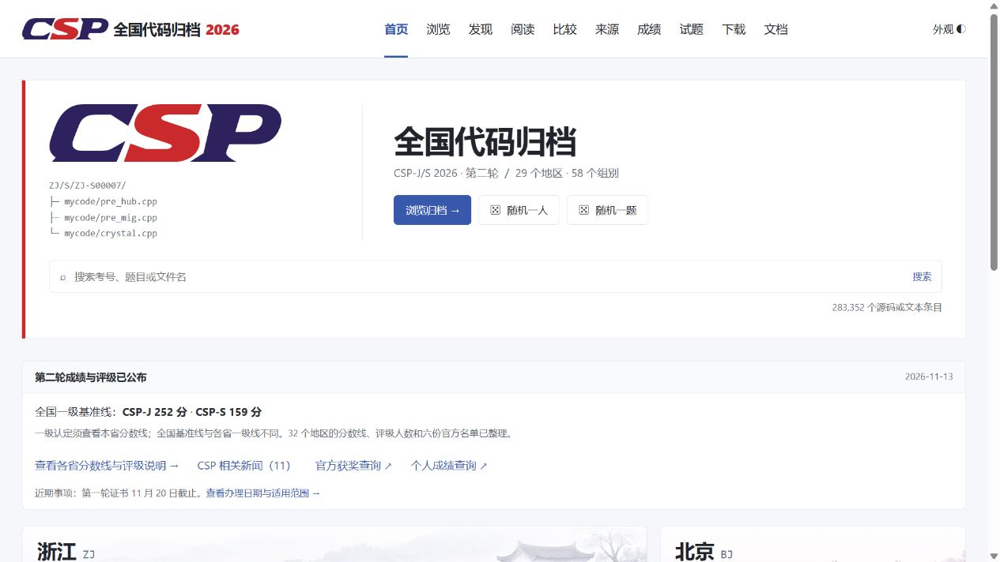</a>

[在线归档](https://tangyixiao.github.io/CSP-2026/) · [试题 PDF](https://tangyixiao.github.io/CSP-2026/papers/) · [代码阅读与对比](https://tangyixiao.github.io/CSP-2026/code/)

项目与学习方法

**[CSP-2026](https://github.com/tangyixiao/CSP-2026)** 
CSP-J/S 2026 试题与选手文件归档。支持在线阅读试题、浏览代码、并排或行内对比，以及按需下载；适合赛后查资料、看实现和做复盘。

**[OJ NEXUS](https://github.com/tangyixiao/OJ-NEXUS)** 
以 Android 为主的多 OJ 客户端，把账号、提交、题目、比赛、训练与复盘放到一起。笔记、历史与统计采用本地优先的方式；其他平台也在继续开发。

**[oi-coach](https://github.com/tangyixiao/oi-coach) / [evidence-learning](https://github.com/tangyixiao/evidence-learning)** 
两份可以交给 AI 使用的教学与学习技能：前者关注 OI 的讲解、分级提示、代码批改和赛后复盘；后者整理高中学习中的记录、复习和延迟复测方法。它们也是我继续改进学习过程的一部分。

更多学习资料与记录

- [CSP-ChuSai](https://github.com/tangyixiao/CSP-ChuSai)：自制提高级初赛模拟卷、参考答案与解析，以及往届资料。自制试卷并非官方试题。
- [tangyixiao-skills](https://github.com/tangyixiao/tangyixiao-skills)：个人使用的 Codex skills 备份与同步合集，保留各项来源和许可。

两条之前记下的洛谷 AC 里程碑：

- **2026.01 — 1000 AC**
- **2026.06 — 2000 AC**

## AI 编程工具与社区插件

我关注 LLM、Agent 和编程工具怎样进入实际工作流：项目放在哪里、会话怎样继续、模型如何接入，以及遇到问题时怎样定位。

<a href="https://github.com/tangyixiao/HarnessHub"></a>

<a href="https://github.com/tangyixiao/dsh-plugin-market"></a>
<a href="https://github.com/tangyixiao/dsh-plugins-sync"></a>

关于这些项目

**[Harness Hub](https://github.com/tangyixiao/HarnessHub)** 
本地优先的 AI 编程桌面控制中心，用来登记项目、发现本机 Harness、管理支持的终端会话，并查看活动、使用量与会话期间的 Git 变更。

**[WorkBuddy Connect Community](https://github.com/tangyixiao/dsh-workbuddy-connect-community)** 
DeepSeek Harness 的 WorkBuddy 社区连接插件。沿用 WorkBuddy / WorkBuddy AI 的桌面登录，分别接入模型、上下文选项与实际观察到的用量。

**[DSH Plugin Market](https://github.com/tangyixiao/dsh-plugin-market) / [dsh-plugins-sync](https://github.com/tangyixiao/dsh-plugins-sync)** 
一个是公开插件索引与市场入口，一个整理多来源的目录快照。希望在发现和安装插件时，能看清来源、版本、通道与冲突。

其他维护中的 DSH 工具

<a href="https://github.com/tangyixiao/dsh-provider-doctor"></a>
<a href="https://github.com/tangyixiao/dsh-version-manager"></a>

社区插件和改编项目的来源、兼容范围及使用方法，见各自仓库。

### 近期开发与协作

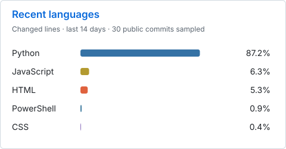

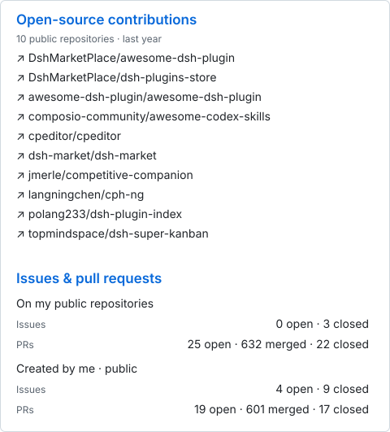

## 网站、可视化与表达

<a href="https://github.com/tangyixiao/tangyixiao.github.io"></a>

**[个人网站](https://tangyixiao.github.io/) / [源码](https://github.com/tangyixiao/tangyixiao.github.io)** 
用来放项目、博客和一些独立运行的小实验。除了页面和交互本身，也在琢磨怎样把数学、物理里的现象画出来，让人可以动手试一试。

<a href="https://tangyixiao.github.io/blackhole.html">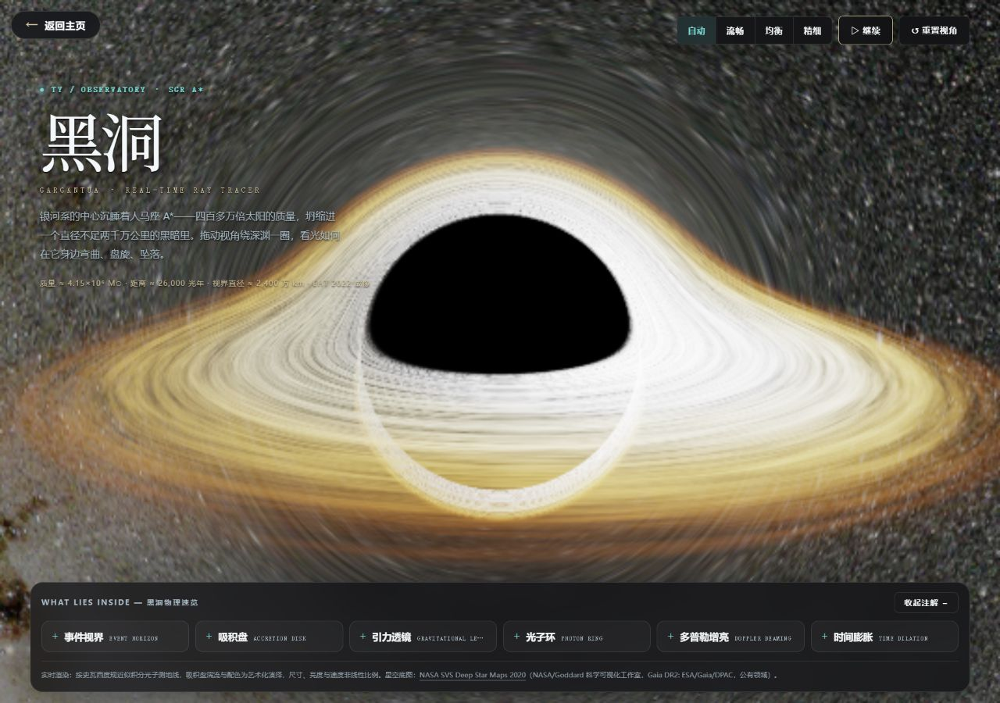</a>

🌌 [黑洞与引力透镜](https://tangyixiao.github.io/blackhole.html) · [三体引力实验](https://tangyixiao.github.io/threebody.html) · [双摆与混沌](https://tangyixiao.github.io/thechao.html)

**[DrawAI Video Studio](https://github.com/tangyixiao/drawai-video-studio)** 
基于 Remotion / React 的视频制作 skill，从参考、分镜和短片试做到可编辑场景、渲染与画面检查。也在尝试把讲解和演示做成更容易看懂的表达。

<a href="https://github.com/tangyixiao/drawai-video-studio/tree/main/examples/paper-storyboard">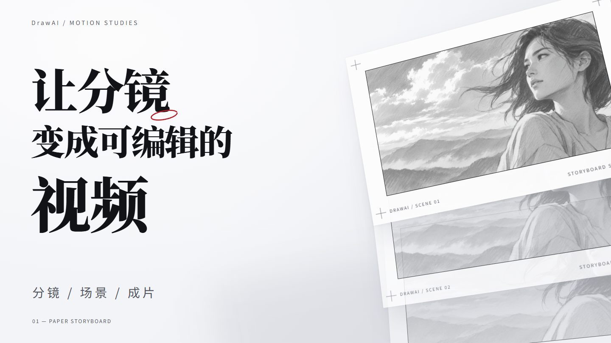</a>

## 写过的一些东西

- **[从一道题，到一份可复用的题解](https://tangyixiao.github.io/blog/posts/problem-to-note.html)** 
  从问题模型和朴素做法出发，把观察、正确性、复杂度与边界一起写清楚。
- **[把推导写清楚，把理解留住](https://tangyixiao.github.io/blog/posts/proof-and-notes.html)** 
  数学笔记除了结论，也应留下条件、每一步的理由和还没想明白的地方。
- **[用一个小实验，理解智能体](https://tangyixiao.github.io/blog/posts/agent-experiment.html)** 
  用范围明确、结果可核对的任务，理解工具、反馈和验证怎样连起来。

## 项目里用到的技术

项目里用到的语言、框架和工具包括但不限于：

  
  
  
  
  
  

- **算法与资料**：C++、Python、LaTeX、Markdown。
- **网页与插件**：TypeScript、React、Three.js、Node.js。
- **客户端与桌面工具**：Kotlin / Jetpack Compose、Rust / Tauri。
- **协作与记录**：Git、GitHub、Issues、Pull Requests。

## 贡献足迹

### 立体贡献日历

<picture>
<source media="(max-width: 640px)" srcset="assets/generated/isometric-mobile.svg">
</picture>

### 3D 贡献景观

<picture>
<source media="(max-width: 640px)" srcset="assets/generated/contribution-3d-mobile.svg">
<source media="(prefers-color-scheme: dark)" srcset="assets/generated/contribution-3d-dark.svg">
</picture>

语言分布与贡献类型

<picture>
<source media="(max-width: 640px)" srcset="assets/generated/contribution-details-mobile.svg">
</picture>

### 近期贡献趋势

<picture>
<source media="(prefers-color-scheme: dark) and (max-width: 640px)" srcset="assets/generated/activity-mobile.svg">
<source media="(max-width: 640px)" srcset="assets/generated/activity-mobile.svg">
<source media="(prefers-color-scheme: dark)" srcset="https://github-readme-activity-graph.ashutosh-dwivedi0710.workers.dev/graph?username=tangyixiao&amp;bg_color=0d1117&amp;color=e6edf3&amp;title_color=58a6ff&amp;line=58a6ff&amp;point=58a6ff&amp;area_color=12243a&amp;border_color=30363d&amp;area=true&amp;radius=6&amp;height=260&amp;days=31&amp;custom_title=Recent%2031%20days">

</picture>

## 在其他地方找到我

[个人网站](https://tangyixiao.github.io/) · [洛谷博客](https://www.luogu.com.cn/blog/TangyixiaoQAQ/) · [Bilibili](https://space.bilibili.com/512272131) 
[GitHub 项目](https://github.com/tangyixiao?tab=repositories) · [提交记录](https://github.com/search?q=author%3Atangyixiao&type=commits) · [Pull Requests](https://github.com/pulls?q=is%3Apr+author%3Atangyixiao)

其他博客与平台

[博客园](https://home.cnblogs.com/u/TangyixiaoQAQ) · [CSDN](https://blog.csdn.net/DCMyyds)

