[English](README.md) · [简体中文](README.zh-CN.md) · [Deutsch](README.de.md) · [Français](README.fr.md) · **Русский**

### Привет, я Adrian Werner Keller

Инженер-программист, специализирующийся на **ИИ-агентах для разработки, инженерной инфраструктуре, алгоритмах и интерактивных WebGL-симуляциях**.

Я создаю инструменты, которые делают агентные рабочие процессы наблюдаемыми, воспроизводимыми и быстрыми в итерации — наряду с системным ПО, нативными клиентами и экспериментами в вычислительной физике.

- **Агентный тулинг:** экосистемы плагинов, мосты для провайдеров моделей, read-only диагностика и проверяемые процессы релизов.
- **Системы и алгоритмы:** производительные инструменты на C++, Rust и TypeScript с детерминированными тестами.
- **Графика и физика:** симуляции орбитальной механики, хаоса и гравитационного линзирования в реальном времени на Three.js / WebGL.

**[Веб-сайт](https://tangyixiao.github.io/)** · **[Репозитории](https://github.com/tangyixiao?tab=repositories)** · **[Pull Requests](https://github.com/pulls?q=is%3Apr+author%3Atangyixiao)**

---

## Активность на GitHub

<a href="https://github.com/tangyixiao">
<picture>
<source media="(prefers-color-scheme: dark) and (max-width: 640px)" srcset="https://github-stats-extended.vercel.app/api?username=tangyixiao&amp;show_icons=true&amp;include_all_commits=true&amp;hide_border=false&amp;border_radius=6&amp;bg_color=0d1117&amp;title_color=58a6ff&amp;text_color=e6edf3&amp;icon_color=58a6ff&amp;border_color=30363d&amp;hide_rank=true&amp;show=prs_merged,prs_merged_percentage">
<source media="(max-width: 640px)" srcset="https://github-stats-extended.vercel.app/api?username=tangyixiao&amp;show_icons=true&amp;include_all_commits=true&amp;hide_border=false&amp;border_radius=6&amp;bg_color=ffffff&amp;title_color=0969da&amp;text_color=1f2328&amp;icon_color=0969da&amp;border_color=d1d9e0&amp;hide_rank=true&amp;show=prs_merged,prs_merged_percentage">
<source media="(prefers-color-scheme: dark)" srcset="https://github-stats-extended.vercel.app/api?username=tangyixiao&amp;show_icons=true&amp;include_all_commits=true&amp;hide_border=false&amp;border_radius=6&amp;bg_color=0d1117&amp;title_color=58a6ff&amp;text_color=e6edf3&amp;icon_color=58a6ff&amp;border_color=30363d&amp;show=prs_merged,prs_merged_percentage">

</picture>
</a>
<a href="https://github.com/tangyixiao?tab=repositories">
<picture>
<source media="(prefers-color-scheme: dark) and (max-width: 640px)" srcset="https://github-stats-extended.vercel.app/api/top-langs/?username=tangyixiao&amp;layout=compact&amp;langs_count=8&amp;card_width=300&amp;border_radius=6&amp;bg_color=0d1117&amp;title_color=58a6ff&amp;text_color=e6edf3&amp;icon_color=58a6ff&amp;border_color=30363d">
<source media="(max-width: 640px)" srcset="https://github-stats-extended.vercel.app/api/top-langs/?username=tangyixiao&amp;layout=compact&amp;langs_count=8&amp;card_width=300&amp;border_radius=6&amp;bg_color=ffffff&amp;title_color=0969da&amp;text_color=1f2328&amp;icon_color=0969da&amp;border_color=d1d9e0">
<source media="(prefers-color-scheme: dark)" srcset="https://github-stats-extended.vercel.app/api/top-langs/?username=tangyixiao&amp;layout=compact&amp;langs_count=8&amp;card_width=450&amp;border_radius=6&amp;bg_color=0d1117&amp;title_color=58a6ff&amp;text_color=e6edf3&amp;icon_color=58a6ff&amp;border_color=30363d">

</picture>
</a>

<a href="https://github.com/tangyixiao">
<picture>
<source media="(prefers-color-scheme: dark) and (max-width: 640px)" srcset="https://streak-stats.demolab.com?user=tangyixiao&amp;hide_border=false&amp;border_radius=6&amp;card_width=390&amp;card_height=195&amp;background=0D1117&amp;border=30363D&amp;stroke=30363D&amp;ring=58A6FF&amp;fire=58A6FF&amp;currStreakNum=E6EDF3&amp;sideNums=E6EDF3&amp;currStreakLabel=58A6FF&amp;sideLabels=58A6FF&amp;dates=9198A1">
<source media="(max-width: 640px)" srcset="https://streak-stats.demolab.com?user=tangyixiao&amp;hide_border=false&amp;border_radius=6&amp;card_width=390&amp;card_height=195&amp;background=FFFFFF&amp;border=D1D9E0&amp;stroke=D1D9E0&amp;ring=0969da&amp;fire=0969da&amp;currStreakNum=1f2328&amp;sideNums=1f2328&amp;currStreakLabel=0969DA&amp;sideLabels=0969DA&amp;dates=59636E">
<source media="(prefers-color-scheme: dark)" srcset="https://streak-stats.demolab.com?user=tangyixiao&amp;hide_border=false&amp;border_radius=6&amp;card_width=840&amp;card_height=195&amp;background=0D1117&amp;border=30363D&amp;stroke=30363D&amp;ring=58A6FF&amp;fire=58A6FF&amp;currStreakNum=E6EDF3&amp;sideNums=E6EDF3&amp;currStreakLabel=58A6FF&amp;sideLabels=58A6FF&amp;dates=9198A1">

</picture>
</a>

---

## Избранные проекты

<a href="https://github.com/tangyixiao/dsh-workbuddy-connect-community"><picture>
<source media="(prefers-color-scheme: dark)" srcset="https://github-stats-extended.vercel.app/api/pin/?username=tangyixiao&amp;repo=dsh-workbuddy-connect-community&amp;card_width=390&amp;description_lines_count=3&amp;border_radius=6&amp;bg_color=0d1117&amp;title_color=58a6ff&amp;text_color=e6edf3&amp;icon_color=58a6ff&amp;border_color=30363d">

</picture></a>
<a href="https://github.com/tangyixiao/drawai-video-studio"><picture>
<source media="(prefers-color-scheme: dark)" srcset="https://github-stats-extended.vercel.app/api/pin/?username=tangyixiao&amp;repo=drawai-video-studio&amp;card_width=390&amp;description_lines_count=3&amp;border_radius=6&amp;bg_color=0d1117&amp;title_color=58a6ff&amp;text_color=e6edf3&amp;icon_color=58a6ff&amp;border_color=30363d">

</picture></a>
<a href="https://github.com/tangyixiao/dsh-plugin-market"><picture>
<source media="(prefers-color-scheme: dark)" srcset="https://github-stats-extended.vercel.app/api/pin/?username=tangyixiao&amp;repo=dsh-plugin-market&amp;card_width=390&amp;description_lines_count=3&amp;border_radius=6&amp;bg_color=0d1117&amp;title_color=58a6ff&amp;text_color=e6edf3&amp;icon_color=58a6ff&amp;border_color=30363d">

</picture></a>
<a href="https://github.com/tangyixiao/tangyixiao.github.io"><picture>
<source media="(prefers-color-scheme: dark)" srcset="https://github-stats-extended.vercel.app/api/pin/?username=tangyixiao&amp;repo=tangyixiao.github.io&amp;card_width=390&amp;description_lines_count=3&amp;border_radius=6&amp;bg_color=0d1117&amp;title_color=58a6ff&amp;text_color=e6edf3&amp;icon_color=58a6ff&amp;border_color=30363d">

</picture></a>

### ИИ-агенты и инструменты для разработчиков

Модульные и наблюдаемые инструменты для агентных сред, каталогов плагинов и проверяемой поставки:

<a href="https://github.com/tangyixiao/HarnessHub"></a>
<a href="https://github.com/tangyixiao/dsh-workbuddy-connect-community"></a>
<a href="https://github.com/tangyixiao/dsh-plugin-market"></a>
<a href="https://github.com/tangyixiao/dsh-plugins-sync"></a>

- **[HarnessHub](https://github.com/tangyixiao/HarnessHub)** (`Rust`) — Хаб и инструменты управления агентными средами и расширениями.
- **[dsh-plugin-market](https://github.com/tangyixiao/dsh-plugin-market)** & **[dsh-plugins-sync](https://github.com/tangyixiao/dsh-plugins-sync)** (`JavaScript`) — Независимый индекс плагинов и синхронизация каталога между устройствами с воспроизводимой установкой.
- **[dsh-workbuddy-connect-community](https://github.com/tangyixiao/dsh-workbuddy-connect-community)** (`TypeScript`) — Плагин провайдера моделей с поддержкой потокового вывода.
- **[tangyixiao-workflow](https://github.com/tangyixiao/tangyixiao-workflow)** (`JavaScript`) — CLI-инструмент для заметок о релизах, проверки Git-тегов и учёта артефактов.

Другие плагины и диагностика

<a href="https://github.com/tangyixiao/dsh-pr-release-workspace"></a>
<a href="https://github.com/tangyixiao/dsh-provider-doctor"></a>
<a href="https://github.com/tangyixiao/dsh-version-manager"></a>
<a href="https://github.com/tangyixiao/dsh-zcode-plan-bridge"></a>

- **[dsh-provider-doctor](https://github.com/tangyixiao/dsh-provider-doctor)** (`TypeScript`) — Read-only диагностика подключений: хост, плагины, регистрация, учётные данные и каталог в одном отчёте.
- **[dsh-pr-release-workspace](https://github.com/tangyixiao/dsh-pr-release-workspace)** (`JavaScript`) — Read-only панель для diff-ов PR, комментариев, локальных заметок и проверки релизов.
- **[dsh-version-manager](https://github.com/tangyixiao/dsh-version-manager)** (`JavaScript`) — Управление версиями плагинов и навыков на основе проверяемых снимков.
- **[dsh-zcode-plan-bridge](https://github.com/tangyixiao/dsh-zcode-plan-bridge)** (`JavaScript`) — Мост провайдера моделей со стримингом, вводом изображений и переиспользованием сессий.

### Недавняя разработка и Open Source

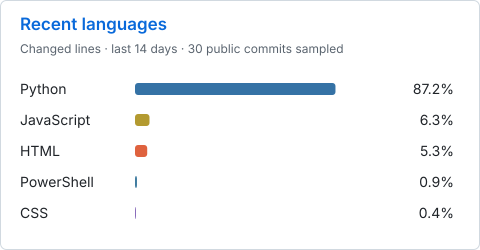

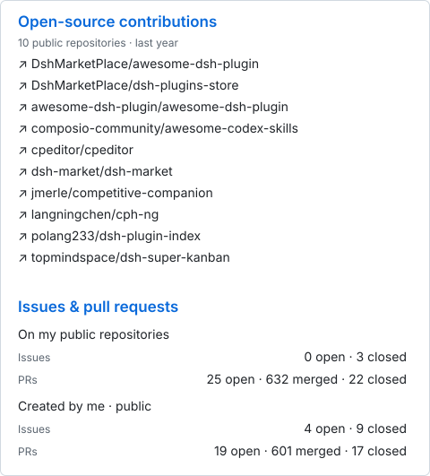

### Интерактивная графика, медиа и нативные клиенты

<a href="https://github.com/tangyixiao/tangyixiao.github.io"></a>
<a href="https://github.com/tangyixiao/drawai-video-studio"></a>
<a href="https://github.com/tangyixiao/OJ-NEXUS"></a>

- **[tangyixiao.github.io](https://github.com/tangyixiao/tangyixiao.github.io)** (`TypeScript` / `React` / `Three.js`) — Личный сайт и WebGL-площадка: интерактивная Солнечная система, гравитационная линза Гаргантюа, задача трёх тел и хаотический двойной маятник.
- **[drawai-video-studio](https://github.com/tangyixiao/drawai-video-studio)** (`TypeScript`) — Движок программной генерации видео на редактируемых сценах Remotion с визуальной верификацией.
- **[OJ-NEXUS](https://github.com/tangyixiao/OJ-NEXUS)** (`Kotlin` / `Jetpack Compose`) — Нативный Android-клиент для алгоритмических платформ.
- **[sublime-cph](https://github.com/tangyixiao/sublime-cph)**, **[sublime-contest-build](https://github.com/tangyixiao/sublime-contest-build)**, **[sublime-contest-complete](https://github.com/tangyixiao/sublime-contest-complete)** & **[sublime-sylvan-theme](https://github.com/tangyixiao/sublime-sylvan-theme)** (`Python`) — Сборка C++, автотестирование, локальное автодополнение через Ollama и тёмно-хвойная тема для Sublime Text.

---

## Технологический стек

Основные языки, фреймворки и инструменты в моих проектах:

  
  
  
  
  
  

- **Системы и ядро:** Rust, C++, Python
- **Веб и тулинг:** TypeScript, React, Three.js, Node.js
- **Мобайл и десктоп:** Kotlin / Jetpack Compose, Tauri
- **Инженерия:** Git, GitHub Actions, детерминированные юнит- и браузерные тесты

---

## История вклада

### Изометрический календарь

<picture>
<source media="(max-width: 640px)" srcset="assets/generated/isometric-mobile.svg">
</picture>

### 3D-ландшафт вклада

<picture>
<source media="(max-width: 640px)" srcset="assets/generated/contribution-3d-mobile.svg">
<source media="(prefers-color-scheme: dark)" srcset="assets/generated/contribution-3d-dark.svg">
</picture>

Языки и типы вклада

<picture>
<source media="(max-width: 640px)" srcset="assets/generated/contribution-details-mobile.svg">
</picture>

### Недавняя активность

<picture>
<source media="(prefers-color-scheme: dark) and (max-width: 640px)" srcset="assets/generated/activity-mobile.svg">
<source media="(max-width: 640px)" srcset="assets/generated/activity-mobile.svg">
<source media="(prefers-color-scheme: dark)" srcset="https://github-readme-activity-graph.ashutosh-dwivedi0710.workers.dev/graph?username=tangyixiao&amp;bg_color=0d1117&amp;color=e6edf3&amp;title_color=58a6ff&amp;line=58a6ff&amp;point=58a6ff&amp;area_color=12243a&amp;border_color=30363d&amp;area=true&amp;radius=6&amp;height=260&amp;days=31&amp;custom_title=Recent%2031%20days">

</picture>

---

## Ссылки

[Веб-сайт](https://tangyixiao.github.io/) · [Репозитории GitHub](https://github.com/tangyixiao?tab=repositories) · [Коммиты](https://github.com/search?q=author%3Atangyixiao&type=commits) · [Pull Requests](https://github.com/pulls?q=is%3Apr+author%3Atangyixiao)
