[English](README.md) · **简体中文** · [Deutsch](README.de.md) · [Français](README.fr.md) · [Русский](README.ru.md)

### 你好，我是 Adrian Werner Keller

软件工程师，长期关注 **AI 编程智能体、开发者基础设施、算法系统与交互式 WebGL 物理模拟**。

主要构建可观测、可复现、易于迭代的智能体工作流工具，同时也开发系统软件、原生客户端与计算物理可视化实验。

- **智能体工具链**：插件生态、模型 Provider 桥接、只读连接诊断与可验证的发布流程。
- **系统与算法**：注重性能与可测试性的 C++、Rust 与 TypeScript 工具开发。
- **图形与物理**：基于 Three.js / WebGL 的天体轨道、混沌系统与黑洞引力透镜实时模拟。

**[个人网站](https://tangyixiao.github.io/)** · **[公开仓库](https://github.com/tangyixiao?tab=repositories)** · **[Pull Requests](https://github.com/pulls?q=is%3Apr+author%3Atangyixiao)**

---

## GitHub 活动

<a href="https://github.com/tangyixiao">
<picture>
<source media="(prefers-color-scheme: dark) and (max-width: 640px)" srcset="https://github-stats-extended.vercel.app/api?username=tangyixiao&amp;show_icons=true&amp;include_all_commits=true&amp;hide_border=false&amp;border_radius=6&amp;bg_color=0d1117&amp;title_color=58a6ff&amp;text_color=e6edf3&amp;icon_color=58a6ff&amp;border_color=30363d&amp;hide_rank=true&amp;show=prs_merged,prs_merged_percentage">
<source media="(max-width: 640px)" srcset="https://github-stats-extended.vercel.app/api?username=tangyixiao&amp;show_icons=true&amp;include_all_commits=true&amp;hide_border=false&amp;border_radius=6&amp;bg_color=ffffff&amp;title_color=0969da&amp;text_color=1f2328&amp;icon_color=0969da&amp;border_color=d1d9e0&amp;hide_rank=true&amp;show=prs_merged,prs_merged_percentage">
<source media="(prefers-color-scheme: dark)" srcset="https://github-stats-extended.vercel.app/api?username=tangyixiao&amp;show_icons=true&amp;include_all_commits=true&amp;hide_border=false&amp;border_radius=6&amp;bg_color=0d1117&amp;title_color=58a6ff&amp;text_color=e6edf3&amp;icon_color=58a6ff&amp;border_color=30363d&amp;show=prs_merged,prs_merged_percentage">

</picture>
</a>
<a href="https://github.com/tangyixiao?tab=repositories">
<picture>
<source media="(prefers-color-scheme: dark) and (max-width: 640px)" srcset="https://github-stats-extended.vercel.app/api/top-langs/?username=tangyixiao&amp;layout=compact&amp;langs_count=8&amp;card_width=300&amp;border_radius=6&amp;bg_color=0d1117&amp;title_color=58a6ff&amp;text_color=e6edf3&amp;icon_color=58a6ff&amp;border_color=30363d">
<source media="(max-width: 640px)" srcset="https://github-stats-extended.vercel.app/api/top-langs/?username=tangyixiao&amp;layout=compact&amp;langs_count=8&amp;card_width=300&amp;border_radius=6&amp;bg_color=ffffff&amp;title_color=0969da&amp;text_color=1f2328&amp;icon_color=0969da&amp;border_color=d1d9e0">
<source media="(prefers-color-scheme: dark)" srcset="https://github-stats-extended.vercel.app/api/top-langs/?username=tangyixiao&amp;layout=compact&amp;langs_count=8&amp;card_width=450&amp;border_radius=6&amp;bg_color=0d1117&amp;title_color=58a6ff&amp;text_color=e6edf3&amp;icon_color=58a6ff&amp;border_color=30363d">

</picture>
</a>

<a href="https://github.com/tangyixiao">
<picture>
<source media="(prefers-color-scheme: dark) and (max-width: 640px)" srcset="https://streak-stats.demolab.com?user=tangyixiao&amp;hide_border=false&amp;border_radius=6&amp;card_width=390&amp;card_height=195&amp;background=0D1117&amp;border=30363D&amp;stroke=30363D&amp;ring=58A6FF&amp;fire=58A6FF&amp;currStreakNum=E6EDF3&amp;sideNums=E6EDF3&amp;currStreakLabel=58A6FF&amp;sideLabels=58A6FF&amp;dates=9198A1">
<source media="(max-width: 640px)" srcset="https://streak-stats.demolab.com?user=tangyixiao&amp;hide_border=false&amp;border_radius=6&amp;card_width=390&amp;card_height=195&amp;background=FFFFFF&amp;border=D1D9E0&amp;stroke=D1D9E0&amp;ring=0969da&amp;fire=0969da&amp;currStreakNum=1f2328&amp;sideNums=1f2328&amp;currStreakLabel=0969DA&amp;sideLabels=0969DA&amp;dates=59636E">
<source media="(prefers-color-scheme: dark)" srcset="https://streak-stats.demolab.com?user=tangyixiao&amp;hide_border=false&amp;border_radius=6&amp;card_width=840&amp;card_height=195&amp;background=0D1117&amp;border=30363D&amp;stroke=30363D&amp;ring=58A6FF&amp;fire=58A6FF&amp;currStreakNum=E6EDF3&amp;sideNums=E6EDF3&amp;currStreakLabel=58A6FF&amp;sideLabels=58A6FF&amp;dates=9198A1">

</picture>
</a>

---

## 精选项目

<a href="https://github.com/tangyixiao/dsh-workbuddy-connect-community"><picture>
<source media="(prefers-color-scheme: dark)" srcset="https://github-stats-extended.vercel.app/api/pin/?username=tangyixiao&amp;repo=dsh-workbuddy-connect-community&amp;card_width=390&amp;description_lines_count=3&amp;border_radius=6&amp;bg_color=0d1117&amp;title_color=58a6ff&amp;text_color=e6edf3&amp;icon_color=58a6ff&amp;border_color=30363d">

</picture></a>
<a href="https://github.com/tangyixiao/drawai-video-studio"><picture>
<source media="(prefers-color-scheme: dark)" srcset="https://github-stats-extended.vercel.app/api/pin/?username=tangyixiao&amp;repo=drawai-video-studio&amp;card_width=390&amp;description_lines_count=3&amp;border_radius=6&amp;bg_color=0d1117&amp;title_color=58a6ff&amp;text_color=e6edf3&amp;icon_color=58a6ff&amp;border_color=30363d">

</picture></a>
<a href="https://github.com/tangyixiao/dsh-plugin-market"><picture>
<source media="(prefers-color-scheme: dark)" srcset="https://github-stats-extended.vercel.app/api/pin/?username=tangyixiao&amp;repo=dsh-plugin-market&amp;card_width=390&amp;description_lines_count=3&amp;border_radius=6&amp;bg_color=0d1117&amp;title_color=58a6ff&amp;text_color=e6edf3&amp;icon_color=58a6ff&amp;border_color=30363d">

</picture></a>
<a href="https://github.com/tangyixiao/tangyixiao.github.io"><picture>
<source media="(prefers-color-scheme: dark)" srcset="https://github-stats-extended.vercel.app/api/pin/?username=tangyixiao&amp;repo=tangyixiao.github.io&amp;card_width=390&amp;description_lines_count=3&amp;border_radius=6&amp;bg_color=0d1117&amp;title_color=58a6ff&amp;text_color=e6edf3&amp;icon_color=58a6ff&amp;border_color=30363d">

</picture></a>

### AI 编程智能体与开发者工具

围绕智能体底座、插件目录与可验证的工程交付构建模块化工具链：

<a href="https://github.com/tangyixiao/HarnessHub"></a>
<a href="https://github.com/tangyixiao/dsh-workbuddy-connect-community"></a>
<a href="https://github.com/tangyixiao/dsh-plugin-market"></a>
<a href="https://github.com/tangyixiao/dsh-plugins-sync"></a>

- **[HarnessHub](https://github.com/tangyixiao/HarnessHub)** (`Rust`) — 面向智能体底座与扩展生态的管理工具。
- **[dsh-plugin-market](https://github.com/tangyixiao/dsh-plugin-market)** & **[dsh-plugins-sync](https://github.com/tangyixiao/dsh-plugins-sync)** (`JavaScript`) — 独立的插件目录索引与多设备同步工具，支持排行与可复现安装。
- **[dsh-workbuddy-connect-community](https://github.com/tangyixiao/dsh-workbuddy-connect-community)** (`TypeScript`) — 社区维护的模型 Provider 插件，支持流式输出。
- **[tangyixiao-workflow](https://github.com/tangyixiao/tangyixiao-workflow)** (`JavaScript`) — 用于发布说明、Git 标签校验与产物追踪的命令行工作流。

更多插件与诊断工具

<a href="https://github.com/tangyixiao/dsh-pr-release-workspace"></a>
<a href="https://github.com/tangyixiao/dsh-provider-doctor"></a>
<a href="https://github.com/tangyixiao/dsh-version-manager"></a>
<a href="https://github.com/tangyixiao/dsh-zcode-plan-bridge"></a>

- **[dsh-provider-doctor](https://github.com/tangyixiao/dsh-provider-doctor)** (`TypeScript`) — 只读连接诊断工具，汇总宿主、插件、注册状态、凭据与目录检查结果。
- **[dsh-pr-release-workspace](https://github.com/tangyixiao/dsh-pr-release-workspace)** (`JavaScript`) — 侧边栏只读 PR 与发布核验工作区，聚合 Diff、评论与本地审阅记录。
- **[dsh-version-manager](https://github.com/tangyixiao/dsh-version-manager)** (`JavaScript`) — 基于可验证快照的插件与 Skill 版本管理工具。
- **[dsh-zcode-plan-bridge](https://github.com/tangyixiao/dsh-zcode-plan-bridge)** (`JavaScript`) — 支持流式响应、图像输入与会话复用的模型桥接插件。

### 近期开发与开源协作

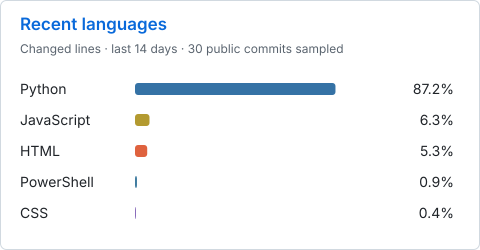

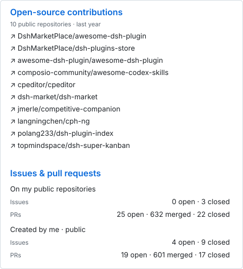

### 交互图形、视频引擎与原生工具

<a href="https://github.com/tangyixiao/tangyixiao.github.io"></a>
<a href="https://github.com/tangyixiao/drawai-video-studio"></a>
<a href="https://github.com/tangyixiao/OJ-NEXUS"></a>

- **[tangyixiao.github.io](https://github.com/tangyixiao/tangyixiao.github.io)** (`TypeScript` / `React` / `Three.js`) — 个人站点与 WebGL 实验场，包含交互式太阳系、卡冈图雅黑洞引力透镜、三体轨道与双摆混沌模拟。
- **[drawai-video-studio](https://github.com/tangyixiao/drawai-video-studio)** (`TypeScript`) — 基于可编辑 Remotion 场景与视觉核验的程序化视频生成引擎。
- **[OJ-NEXUS](https://github.com/tangyixiao/OJ-NEXUS)** (`Kotlin` / `Jetpack Compose`) — 面向算法平台的原生 Android 客户端。
- **[sublime-cph](https://github.com/tangyixiao/sublime-cph)**、**[sublime-contest-build](https://github.com/tangyixiao/sublime-contest-build)**、**[sublime-contest-complete](https://github.com/tangyixiao/sublime-contest-complete)** & **[sublime-sylvan-theme](https://github.com/tangyixiao/sublime-sylvan-theme)** (`Python`) — Sublime Text 下的 C++ 编译测试、本地 Ollama 行内补全与低眩光暗色松绿主题套件。

---

## 技术栈

各项目主要使用的语言、框架与工程工具：

  
  
  
  
  
  

- **系统与核心**：Rust、C++、Python
- **Web 与工具链**：TypeScript、React、Three.js、Node.js
- **移动端与桌面**：Kotlin / Jetpack Compose、Tauri
- **工程实践**：Git、GitHub Actions、确定性单元测试与浏览器自动化测试

---

## 贡献足迹

### 立体贡献日历

<picture>
<source media="(max-width: 640px)" srcset="assets/generated/isometric-mobile.svg">
</picture>

### 3D 贡献景观

<picture>
<source media="(max-width: 640px)" srcset="assets/generated/contribution-3d-mobile.svg">
<source media="(prefers-color-scheme: dark)" srcset="assets/generated/contribution-3d-dark.svg">
</picture>

语言分布与贡献类型

<picture>
<source media="(max-width: 640px)" srcset="assets/generated/contribution-details-mobile.svg">
</picture>

### 近期贡献趋势

<picture>
<source media="(prefers-color-scheme: dark) and (max-width: 640px)" srcset="assets/generated/activity-mobile.svg">
<source media="(max-width: 640px)" srcset="assets/generated/activity-mobile.svg">
<source media="(prefers-color-scheme: dark)" srcset="https://github-readme-activity-graph.ashutosh-dwivedi0710.workers.dev/graph?username=tangyixiao&amp;bg_color=0d1117&amp;color=e6edf3&amp;title_color=58a6ff&amp;line=58a6ff&amp;point=58a6ff&amp;area_color=12243a&amp;border_color=30363d&amp;area=true&amp;radius=6&amp;height=260&amp;days=31&amp;custom_title=Recent%2031%20days">

</picture>

---

## 更多链接

[个人网站](https://tangyixiao.github.io/) · [GitHub 仓库](https://github.com/tangyixiao?tab=repositories) · [Commits](https://github.com/search?q=author%3Atangyixiao&type=commits) · [Pull Requests](https://github.com/pulls?q=is%3Apr+author%3Atangyixiao)
